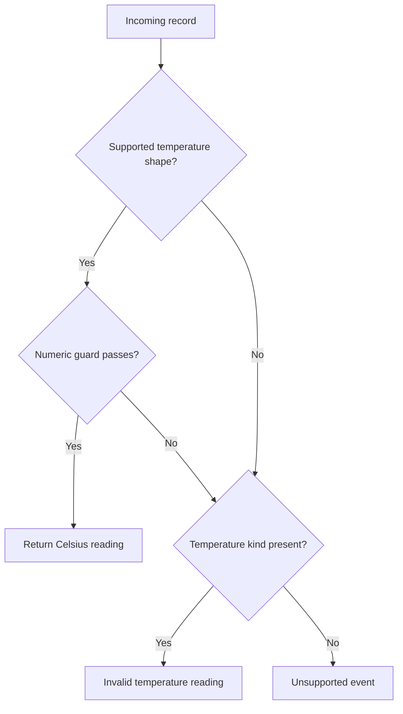

A temperature reading arrives as a dictionary. Before using it, a program checks the message kind, finds the value, checks its type, reads the unit, and decides whether to convert it. The interesting operation may take one line; the code establishing that the operation is safe takes several more.

[Python 3.10, released today](https://www.python.org/downloads/release/python-3100/), gives that preparation a new form. Structural pattern matching lets a branch describe the data it accepts and name the parts it needs. The result can make message handling code easier to inspect: the expected structure appears beside the operation that consumes it.

The feature is worth learning through a concrete boundary: a small function that turns two supported temperature message formats into degrees Celsius.

## A Message Handler You Can Read as a Contract

Suppose a sensor gateway sends records such as `{"kind": "temperature", "value": 68, "unit": "F"}`. This function accepts ordinary Python integers and floats, rejects booleans and non-finite values, and converts supported readings:

```python
import math


def temperature_c(event):
    match event:
        case {"kind": "temperature", "value": value,
              "unit": ("C" | "F") as unit} if (
            type(value) in (int, float) and math.isfinite(value)
        ):
            return value if unit == "C" else (value - 32) * 5 / 9
        case {"kind": "temperature"}:
            raise ValueError("Invalid temperature reading")
        case _:
            raise ValueError("Unsupported event")
```

Read the first case in pieces. The mapping must contain `kind`, `value`, and `unit`. The kind must equal `"temperature"`. The unit must match either `"C"` or `"F"`; `as unit` retains the matched string. The name `value` captures the corresponding field. Only then does the guard after `if` decide whether that value is acceptable.

The exact-type check is deliberate. Python treats `bool` as a subclass of `int`, but a sensor reading of `True` should not become one degree. This example accepts only the two named built-in types; a numerical library's scalar objects would need their own policy.

The [3.10.0 release notes](https://github.com/python/cpython/blob/v3.10.0/Doc/whatsnew/3.10.rst#pep-634-structural-pattern-matching) describe a matching system that combines tests with unpacking. Here that combination lets a reviewer see the supported message format without following a chain of dictionary lookups.

{: w="700" h="394" .shadow }
_The pattern selects fields; the guard decides whether the captured value is acceptable._

## Extra Keys Are an Explicit Design Decision

A mapping pattern checks the keys it names. Other keys are allowed, so adding a sensor identifier does not break this handler:

```python
assert temperature_c({
    "kind": "temperature",
    "value": 68,
    "unit": "F",
    "sensor": "bench-2",
}) == 20.0
```

That behavior is useful when different consumers need different parts of a record. It also means the pattern does not enforce an exact schema. If unexpected fields must be rejected, capture them with `**rest` and check that `rest` is empty, or use a separate schema validator.

The distinction matters for scientific and engineering data. A record can have the right keys and still contain an impossible reading, an incorrect unit, or a value from an uncalibrated instrument. This function checks format and a few numeric conditions. Sensor range, calibration, timestamps, and provenance remain application responsibilities.

> The guard is intentionally small. A protocol accepting arbitrarily large integers needs an explicit size or range check before `math.isfinite`, which can raise `OverflowError` during conversion. Treat the example as a handler for bounded sensor values.
{: .prompt-info }

## Cases Run in Order, Including Their Guards

Python tries cases from top to bottom. A pattern must succeed, and its guard must be true if one is present, before its body runs. A failed guard moves execution to the next case; it does not end the whole statement.

For the handler above, that gives three distinct outcomes:



A record with `"unit": "K"` reaches the second case. So does a Celsius record whose value is `"warm"`. A record with a different kind reaches the final wildcard. The distinction lets a caller separate malformed temperature data from a message this function does not handle.

Case order is part of the contract. Moving `case {"kind": "temperature"}` to the top would intercept every temperature record, including valid ones. Python permits that ordering because the mapping pattern is not an unconditional match. Review and tests must catch the mistake.

The language also permits a `match` statement without a wildcard. If nothing matches, execution continues after the statement. For a function responsible for accepting or rejecting input, an explicit failure path is easier to audit. These control-flow rules are specified in the [Python 3.10.0 language reference](https://github.com/python/cpython/blob/v3.10.0/Doc/reference/compound_stmts.rst#the-match-statement).

## The Surprising Part Is What a Name Means

In ordinary expressions, a name retrieves a value. In a capture pattern, a bare name binds one. A case such as `case expected_kind:` would capture the subject into `expected_kind`, even if that name already held a string.

Use a literal when matching a fixed string, or a qualified name such as `MessageKind.TEMPERATURE` for a named constant. Reserve bare names for values the branch is meant to receive. The wildcard `_` matches without retaining the value.

Patterns extend beyond dictionaries. Sequence patterns can unpack a known number of elements, and class patterns can check a type and read named attributes. A pattern such as `Reading(value=value, unit="C")` tests an existing object's attributes; it does not call the constructor. Positional class patterns use `__match_args__` to map positions to attribute names. That ordering becomes an interface callers can depend on, so keyword patterns often make better library examples.

Daniel F. Moisset's [PEP 636 tutorial](https://peps.python.org/pep-0636/) is a useful introduction to these forms. Its examples also show why patterns deserve their own vocabulary: familiar parentheses and identifiers behave differently in a `case` header.

## Where I Would Use It First

I would start with a parser or message handler whose branches already check several fields before extracting them. The migration has a measurable purpose: put the accepted forms in one place and make each branch's inputs visible. Existing examples of accepted and rejected messages can serve as tests before and after the change.

I would keep an `if` statement for a simple condition and a dictionary for a direct key-to-handler lookup. Pattern matching adds value when a decision depends on structure. Deeply nested patterns or guards with several side effects would make that decision harder to review.

Adopting the syntax also sets a deployment requirement: every interpreter parsing the module must support Python 3.10. A library that still supports 3.9 cannot hide a `match` statement behind a runtime version check; the older parser must read the module first.

The temperature handler offers a useful standard for deciding whether the feature earns its place. A reviewer should be able to identify the accepted shape, the value checks, and the failure behavior from the same small section of code. When those three things become clearer, pattern matching is doing useful engineering work.

## References

- Python Software Foundation, [Python 3.10.0 release](https://www.python.org/downloads/release/python-3100/), October 4, 2021.
- CPython, [What's New in Python 3.10](https://github.com/python/cpython/blob/v3.10.0/Doc/whatsnew/3.10.rst), documentation at the `v3.10.0` release tag.
- CPython, [The `match` statement](https://github.com/python/cpython/blob/v3.10.0/Doc/reference/compound_stmts.rst#the-match-statement), language reference at the `v3.10.0` release tag.
- Brandt Bucher and Guido van Rossum, [PEP 634: Structural Pattern Matching, Specification](https://peps.python.org/pep-0634/).
- Tobias Kohn and Guido van Rossum, [PEP 635: Structural Pattern Matching, Motivation and Rationale](https://peps.python.org/pep-0635/).
- Daniel F. Moisset, [PEP 636: Structural Pattern Matching, Tutorial](https://peps.python.org/pep-0636/).
