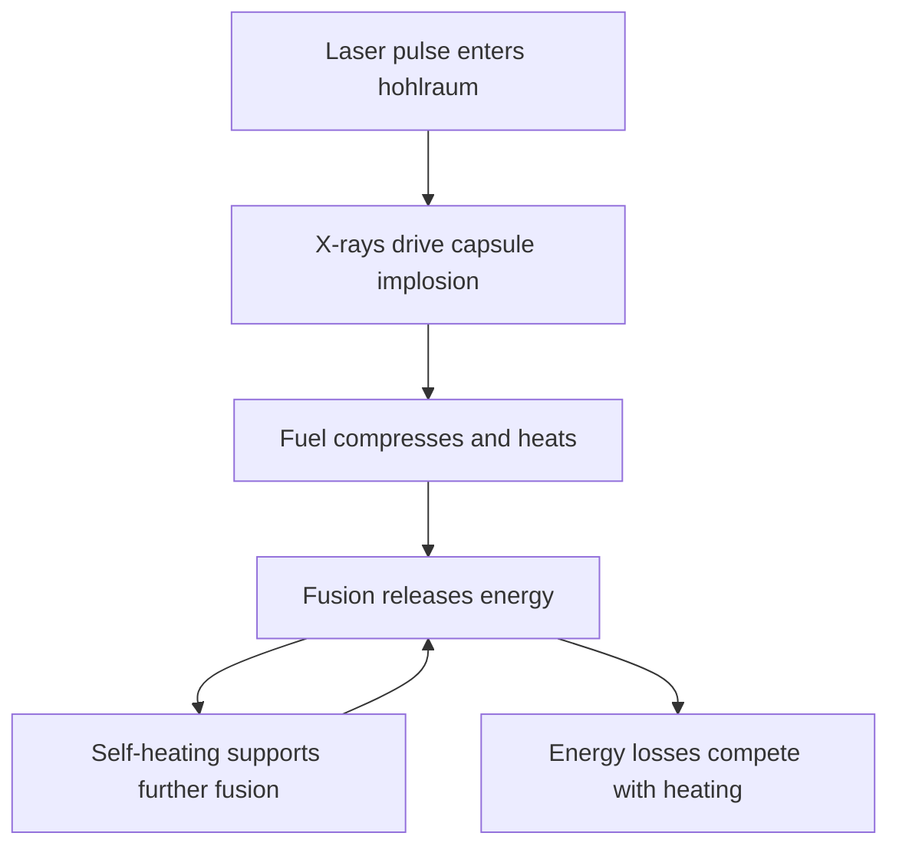

A fusion target at Lawrence Livermore National Laboratory has released more energy than the laser pulse delivered to it. In the December 5 experiment announced today, the National Ignition Facility (NIF) delivered **2.05 megajoules to the target and measured 3.15 megajoules of fusion output**. That puts the reported target gain at approximately **1.54**. [DOE's announcement](https://www.energy.gov/articles/doe-national-laboratory-makes-history-achieving-fusion-ignition) establishes the result.

The achievement gives laser-driven fusion a new experimental footing. It also makes the phrase "energy gain" worth reading carefully. The input in that ratio is laser light reaching the target. The electricity needed to produce the pulse sits outside the calculation.

Understanding that boundary helps explain both the significance of this shot and the engineering work ahead.

{: w="700" h="394" }
_The December 5 shot produced about 54% more fusion energy than the incident laser energy. Both bars use the same scale; neither represents the facility's electrical consumption._

## From Laser Light to a Burning Plasma

NIF uses **indirect-drive inertial confinement fusion**. Its 192 laser beams enter a small enclosure called a hohlraum, with a capsule of deuterium and tritium fuel inside. The heated enclosure emits X-rays that drive the capsule inward. The [University of Rochester's account of today's announcement](https://www.rochester.edu/newscenter/nuclear-fusion-energy-ignition-milestone-544292/) describes the arrangement and contrasts it with direct drive, where lasers illuminate the capsule itself.

The implosion compresses and heats the fuel. Fusion must proceed rapidly during the brief interval before the fuel expands and cools. Some of the energy released by fusion heats the fuel further, allowing the reaction to contribute to its own heating.

When fusion supplies more heating than external compression does, the fuel enters the burning-plasma regime. LLNL's [January report](https://www.llnl.gov/article/48371/nature-paper-chronicles-how-researchers-achieved-burning-plasma-regime-first-time-laboratory) describes reaching that regime in experiments conducted in 2020 and early 2021. Establishing the energy balance required several diagnostics combined with model-based inference. A second analysis group checked the conclusions.

Researchers must determine how much heating comes from fusion, how much comes from compression, and how quickly energy escapes. A large output number alone does not describe the balance inside the fuel.

## What Is New About This Result?

"Ignition" can describe a physical condition within the plasma or an experimental milestone defined by energy gain. Those uses need to be distinguished.

In August, LLNL [reported peer-reviewed results from its August 2021 shot](https://www.llnl.gov/article/48866/three-peer-reviewed-papers-highlight-scientific-results-national-ignition-facility-record). That experiment produced more than 1.3 MJ and met a Lawson-criterion definition of ignition, with self-heating exceeding cooling losses. December's new result crosses another boundary: **fusion output exceeds the laser energy delivered to the entire target**.

| Measure | What It Compares |
| :--- | :--- |
| Burning plasma | Fusion self-heating against external compression heating |
| Ignition within the fuel | Self-heating against the losses that limit the burn |
| Target gain | Fusion energy output against incident laser energy |
| Net electrical output | Electricity generated against all plant electrical inputs |

The first two concern the fuel's behavior. The third includes the energy delivered to drive the target. The fourth concerns a complete generating system. Progress at one boundary matters, but the ratios are not interchangeable.

> Every energy-gain claim needs a named input and output. Here, 3.15 MJ divided by 2.05 MJ is target gain, not electrical efficiency.
{: .prompt-info }

## Why a Gain of 1.54 Does Not Close the Plant Balance

A power plant would have to turn electricity into a driver pulse, release fusion energy, and convert part of that output back into electricity. Each conversion loses energy. Pumps, cooling, controls, and other equipment also draw power.

A simple bookkeeping example makes the implication clear. Suppose a hypothetical driver converts 10% of its electrical input into laser light, and an energy-recovery system converts 40% of the fusion output into electricity. Both efficiencies are assumptions for this example; neither is a measurement of NIF.

For each unit of electricity supplied to that driver, the returned electricity would be:

**0.10 × target gain × 0.40 = 0.04 × target gain.**

Even before supporting equipment is included, that example needs a target gain above 25 to return more electricity than the driver consumes. The required gain changes with the assumed efficiencies. An engineering balance must follow energy through the whole conversion chain.

DOE explicitly identifies substantial further science and technology work before inertial fusion can provide affordable electricity. The target result is one necessary piece of that larger problem.

## The Next Test Is Repeatability

High yield depends on how the capsule implodes. Laser delivery, target shape, and fuel conditions must work together to produce the intended compression.

LLNL's [February report on target design](https://lasers.llnl.gov/news/nature-physics-paper-describes-burning-plasma-target-laser-designs) describes researchers combining HYDRA radiation-hydrodynamics simulations, theory, and models informed by experiments. They adjusted hohlraum geometry and energy transfer between beams to control implosion symmetry. Measurements from tuning shots guided subsequent designs.

The August report also identifies sources of variation: laser performance changes between shots, target quality varies, and the frozen fuel layer can have different surface roughness. Such variation makes repeatability a design requirement.

For the next experimental campaign, the useful evidence would include the spread in yield, the manufacturing tolerances of successful targets, and agreement between predicted and measured conditions. Together, those results would show how much variation the design can tolerate while retaining high performance.

A generating system adds another demand: repetition at an economical rate. Targets become consumables; optics and chamber components become maintenance items. Higher yield helps only if the equipment can sustain useful output over time.

Today's result makes those questions more compelling. NIF has demonstrated target gain above unity. The immediate task is to learn which conditions made it possible, reproduce them, and measure how far the design can move from those conditions before performance falls.

## References

- DOE, [DOE National Laboratory Makes History by Achieving Fusion Ignition](https://www.energy.gov/articles/doe-national-laboratory-makes-history-achieving-fusion-ignition), announcement released for the December 13, 2022 briefing.
- University of Rochester, [Scientists Hit Key Milestone in Fusion Energy Quest](https://www.rochester.edu/newscenter/nuclear-fusion-energy-ignition-milestone-544292/), December 13, 2022.
- LLNL, [Nature Paper Chronicles How Researchers Achieved Burning Plasma Regime](https://www.llnl.gov/article/48371/nature-paper-chronicles-how-researchers-achieved-burning-plasma-regime-first-time-laboratory), January 26, 2022.
- LLNL, [Nature Physics Paper Describes Burning Plasma Target and Laser Designs](https://lasers.llnl.gov/news/nature-physics-paper-describes-burning-plasma-target-laser-designs), February 10, 2022.
- LLNL, [Three Peer-Reviewed Papers Highlight Scientific Results of NIF Record Yield Shot](https://www.llnl.gov/article/48866/three-peer-reviewed-papers-highlight-scientific-results-national-ignition-facility-record), August 8, 2022.
