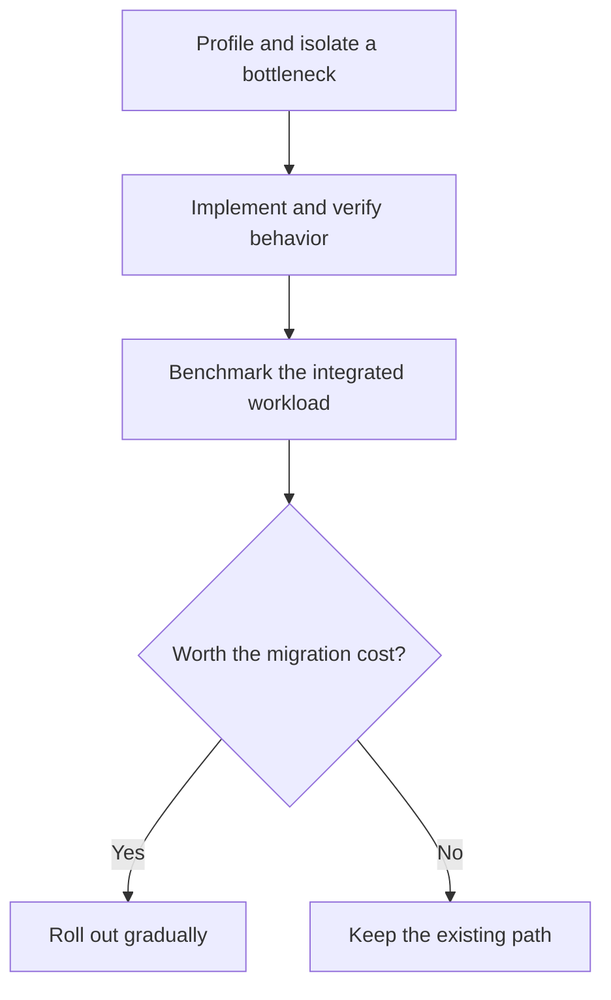

At some point, waiting for a tool becomes an architectural complaint.

The code change is small. The linter, type checker, dependency resolver, and build system still have plenty to say about it. Multiply that pause by a team, its CI jobs, and every branch pushed during a workday, and language implementation stops being an academic argument.

I am increasingly impatient with Python, JavaScript, and Java tools that spend too much of that time on avoidable work. I want the convenience of those ecosystems without treating their tooling overhead as inevitable. Rust makes a compelling offer: spend more effort defining ownership and compiling the program, then give its users less work to wait for.

I have rewritten entire projects in Rust a few times now, and I have been happy with the decision every time. Compile times are the recurring complaint. That experience is part of why these announcements keep catching my attention; I recognize the tradeoff.

The announcements keep coming: compilers, package managers, game engines, image editors. They suggest two changes worth separating. Rust gives developers a practical way to build fast native software with memory-safety checks. AI-assisted porting may also be reducing the cost of trying a new implementation. Today's TypeScript announcement puts both in view.

## Today's Exhibit: TypeScript in Rust

Cloudflare and VoidZero have [announced `tsrs`](https://blog.cloudflare.com/typescript-rust-port), working with Max Schwenk of Owner.com on a Rust port of TypeScript incubated within Oxc. The project intends to preserve upstream language behavior and collaborate with the TypeScript team.

Cloudflare reports **up to 8× faster checking and about 70% less memory than the Go-based TypeScript 7.0**, with equal type-check worker counts. These are project benchmarks, not my measurements; its charts also show a faster TypeScript 7.1 beta.

That baseline matters. Microsoft's [native TypeScript port](https://devblogs.microsoft.com/typescript/typescript-native-port/) already moved away from JavaScript. Its [May 2025 preview](https://devblogs.microsoft.com/typescript/announcing-typescript-native-previews/) credited native compilation and shared-memory parallelism for roughly tenfold improvements on most projects. The tsrs comparison is against another native compiler, not the old JavaScript implementation.

The TypeScript team is learning from tsrs, too. In [today's Hacker News discussion](https://news.ycombinator.com/item?id=50167925), Daniel Rosenwasser says some of the improvements expected to make TypeScript 7.1 faster and more memory-efficient come from optimizations discovered in tsrs. In a [follow-up](https://news.ycombinator.com/item?id=50168904), he recalls examples involving less eager work, different allocation patterns, and experiments with struct layouts. He also cautions against attributing the speed entirely to language choice.

That is a better outcome than a permanent benchmark victory for either team. A second implementation can uncover waste that the original can remove. You may benefit from this Rust port without ever switching to it.

The tsrs release remains experimental, with diagnostic-order differences and compatibility work outstanding. A compiler that runs quickly but accepts different programs would be a very expensive substitute.

## Native Speed Is Only Part of the Rust Argument

Three decisions tend to get bundled into a rewrite: changing language, changing the architecture, and changing how data is stored and shared. A benchmark measures the resulting program. It does not tell us how much each decision contributed.

Go's TypeScript port demonstrates the value of native execution and parallelism. C++ also offers direct control over allocation, contiguous storage, and buffer reuse. Rust's appeal is combining that control with compiler-enforced rules for [ownership and borrowing](https://doc.rust-lang.org/book/ch04-01-what-is-ownership.html), without requiring a tracing garbage collector.

The payoff is especially useful when code changes hands or becomes concurrent. Safe Rust rejects invalid references and prevents data races; its [ownership and concurrency rules](https://doc.rust-lang.org/book/ch16-00-concurrency.html) make many mistakes compilation errors. For a team optimizing shared data structures, that is help maintaining correctness while changing the implementation. It does not eliminate deadlocks or logic errors, and unsafe code still requires its invariants to be checked by people.

WebAssembly adds a deployment reason. Cloudflare emphasizes that Rust avoids shipping a tracing collector with the compiler, which suits its memory-constrained Workers and browser environments. A tool's memory footprint can determine where it runs, not just how much a server costs.

I prefer that combination when I need native performance and control over memory. Go can still be the better fit for a team's codebase and development loop; C++ can be the better fit for an existing native ecosystem. The case for Rust gets stronger when those memory-safety checks and deployment constraints matter together.

## Why More Ports Are Feasible Now

Cloudflare attributes part of the new activity to frontier AI models making large ports feasible in days. It also proposes using agents to track upstream changes and help maintain compatibility. Those are its claims and plans, not proof that arbitrary rewrites are cheap or dependable.

I read that as a change in the cost of experimentation. If producing a candidate implementation costs less, more teams can test one. But a generated port still needs someone to establish which behaviors matter, investigate differences, and maintain it as the original changes. The first successful build is the beginning of that obligation.

Rosenwasser's comment gives this experimentation a useful second purpose: finding optimizations that can travel back upstream. Even a port that never replaces the official compiler can improve the tool developers already use.

## Python Is Losing the Work Around Python

Python's appeal is easy to understand: readable code, fast experiments, and an enormous scientific ecosystem. The frustration starts when a tool spends its life walking syntax trees, resolving packages, or shuffling objects through interpreter-level loops.

[Ruff and uv](https://astral.sh/blog/uv) illustrate a productive response. The developer keeps writing Python while Rust handles linting, formatting, dependency resolution, and installation. uv's design also includes a shared cache and strategies for avoiding redundant downloads and copies. The language enables an efficient implementation; the algorithms and I/O design still matter.

On October 13, Astral [announced experimental uv–ty integration](https://astral.sh/blog/uv-ty-integration), including a unified `uv check` command. The direction is toward a more cohesive toolchain around Python.

It would be stale to blame every Python performance problem on the GIL. CPython has [free-threaded builds](https://docs.python.org/3.14/howto/free-threading-python.html), with extension compatibility still a consideration. Removing that lock does not turn a parser written around Python objects into a compact native parser. Threading and representation are separate decisions.

For this kind of infrastructure, I would rather pay the implementation cost once than make every Python developer keep paying the execution cost.

## Replace the Expensive Work, Keep the Useful Interface

Java deserves a more precise complaint than "the JVM is slow." A warmed-up JVM can deliver excellent throughput. Modern collectors such as [ZGC](https://docs.oracle.com/en/java/javase/17/gctuning/z-garbage-collector1.html) target low pause times. Java teams also inherit mature profilers, libraries, and operational practices.

[Apache DataFusion Comet](https://datafusion.apache.org/comet/) changes the question from whether to abandon that ecosystem to which work should run outside it. Comet accelerates supported Spark query operations through DataFusion's native engine while keeping Spark as the surrounding system. Users can retain the platform while selected operations execute differently.

Cloudflare's [2022 Pingora report](https://blog.cloudflare.com/how-we-built-pingora-the-proxy-that-connects-cloudflare-to-the-internet/) offers a related lesson from a proxy replacement. It reports using about a third of the CPU and memory of its previous infrastructure, alongside substantially improved connection reuse. Rust supported the redesign; the result is not a measurement of language choice alone.

These are stronger business cases than replacing an application because its language annoys me. Find work that dominates the profile, preserve the interface people rely on, and measure whether a different implementation earns its place.

{: w="700" h="394" }
_A common migration pattern: preserve the interface, replace selected expensive work, and choose the deployment targets the engine supports. The diagram is conceptual; individual projects differ._

## Beyond the Toolchain: Games and Creative Apps

The ambition extends to software we interact with all day. [doukutsu-rs](https://github.com/doukutsu-rs/doukutsu-rs) reimplements the **Cave Story engine** while using game data from supported editions. [Pumpkin](https://github.com/Pumpkin-MC/Pumpkin) independently implements a **Minecraft server**. Neither claim means the original publisher has ported its entire game. [Veloren](https://book.veloren.net/introduction/what-is-veloren.html), by contrast, is an original Rust game: evidence of adoption, not a rewrite.

Creative applications put different demands on the implementation. [PhotoCraft](https://github.com/storytold/photocraft), from the [ArtCraft lineup](https://getartcraft.com/apps), describes a clean-room implementation of Photoshop-style functionality. Its document model and command engine sit beneath an egui interface, with CPU and wgpu compositors and copy-on-write image tiles. That separation interests me more than the feature checklist: large documents need efficient storage and expensive image operations need room to run without entangling the interface.

PhotoCraft and [VectorCraft](https://github.com/storytold/vectorcraft) also target native desktops and WebAssembly. ArtCraft labels these projects early alpha or in development. I have not validated them as production replacements; file fidelity, color handling, typography, and real working documents will decide that. They show how far developers are willing to take a Rust implementation, not how many established applications it has already displaced.

## The Waiting Moved to Compile Time

Rust does have an impressive ability to make a fast program take a while to exist.

There are concrete reasons. [Monomorphization](https://rustc-dev-guide.rust-lang.org/backend/monomorph.html) generates specialized code for the concrete types used with generics. That can improve runtime performance while increasing compiler work and binary size. Macro expansion, type checking, dependency graphs, optimization, and linking add their own costs. Blaming the borrow checker for all of it is too convenient.

The economics differ for a tool's author and its users. A maintainer waits for compilation; someone installing a prebuilt release usually does not. A widely used linter can amortize an expensive build across many thousands of runs. A small team rebuilding a large Rust service throughout the day gets a less forgiving bargain.

Measure that bargain. [Cargo's timing report](https://doc.rust-lang.org/cargo/reference/timings.html) shows compilation units and dependency bottlenecks:

```console
cargo build --timings
```

The report is written to `target/cargo-timings/cargo-timing.html`{: .filepath}. Use it to identify expensive dependencies, unnecessary features, and work that prevents other crates from starting. Record clean builds and the edit–test cycle separately; they affect developers in different ways.

In my own rewrites, splitting the project into crates has often helped with the compile-time complaint. That is why I look at project structure before accepting a slow build loop. The useful boundary is between stable, reusable code and the application code changing all afternoon, not an arbitrary target number of crates. The [Rust Book's workspace chapter](https://doc.rust-lang.org/book/ch14-03-cargo-workspaces.html) explains how to manage related packages with a shared lockfile and build directory, and the Cargo Book recommends splitting large crates when investigating build times.

That gives Cargo opportunities to reuse unchanged work and compile independent pieces concurrently. It is not a rule that more crates always means faster builds: a long dependency chain still serializes work, changes to a widely used crate can affect many dependents, and linking still takes time. Measure the dependency graph you actually have.

Read the Rust handbook, lol. More specifically, read the Rust Book and the Cargo Book before accepting a painful build loop as the price of admission. Crate boundaries, dependency features, and development profiles deserve the same attention as runtime performance. The compile-time annoyance has never made me regret one of my rewrites, but it has earned some architectural attention.

## A Rewrite Still Has to Pay for Itself

Compile times are the most obvious punchline, but they are not the only cost. Ownership takes practice. Existing libraries may be better in the original ecosystem. FFI boundaries need care, and compatibility work can last far longer than the initial port. Safe Rust also cannot prevent a wrong algorithm, a deadlock, or an authorization bug.

I have been happy with whole-project rewrites, but that experience is not a reason to make the whole project the default unit of replacement. Start where the waste is measurable: a parser, a resolver, a hot query operator, a proxy. Put the same inputs through both implementations. Compare outputs and failures, then measure the whole workflow. Include the cost of crossing the language boundary. Keep a way to fall back.



I want fewer tools that treat my CPU and memory as an unlimited subsidy for their implementation choices. Rust gives their authors a credible way to do better. Python can remain the notebook, TypeScript the application, and Java the service API while the machinery underneath gets leaner.

I am happy to see more of that machinery written in Rust. I would also like `cargo build` to finish before I come up with another article about it.

## References

- Cloudflare, [Introducing tsrs: A port of TypeScript to Rust](https://blog.cloudflare.com/typescript-rust-port), October 20, 2026.
- Astral, [uv: Python packaging in Rust](https://astral.sh/blog/uv), February 15, 2024; [Bringing uv and ty together](https://astral.sh/blog/uv-ty-integration), October 13, 2026.
- Microsoft, [A 10x Faster TypeScript](https://devblogs.microsoft.com/typescript/typescript-native-port/), March 11, 2025; [Announcing TypeScript Native Previews](https://devblogs.microsoft.com/typescript/announcing-typescript-native-previews/), May 22, 2025.
- Daniel Rosenwasser, [TypeScript team comment on optimizations discovered in tsrs](https://news.ycombinator.com/item?id=50167925) and [follow-up on allocation and data-layout changes](https://news.ycombinator.com/item?id=50168904), Hacker News, October 20, 2026.
- Apache DataFusion, [Comet architecture](https://datafusion.apache.org/comet/).
- Game projects: [doukutsu-rs](https://github.com/doukutsu-rs/doukutsu-rs), [Pumpkin](https://github.com/Pumpkin-MC/Pumpkin), and [What is Veloren?](https://book.veloren.net/introduction/what-is-veloren.html).
- ArtCraft, [Crafting Apps](https://getartcraft.com/apps), [PhotoCraft implementation](https://github.com/storytold/photocraft), and [VectorCraft implementation](https://github.com/storytold/vectorcraft).
- Cloudflare, [How we built Pingora](https://blog.cloudflare.com/how-we-built-pingora-the-proxy-that-connects-cloudflare-to-the-internet/), September 14, 2022.
- Rust project, [Ownership](https://doc.rust-lang.org/book/ch04-01-what-is-ownership.html), [Fearless concurrency](https://doc.rust-lang.org/book/ch16-00-concurrency.html), [Cargo workspaces](https://doc.rust-lang.org/book/ch14-03-cargo-workspaces.html), [Monomorphization](https://rustc-dev-guide.rust-lang.org/backend/monomorph.html), and [Cargo build timings](https://doc.rust-lang.org/cargo/reference/timings.html).

_Written against public announcements and documentation available on October 20, 2026. Reported performance results belong to their respective projects; they are not a common benchmark suite._
